<h1 align="center">Caparaó</h1>

  
  
  

<b>Brew better coffee with the scale you already have.</b>

Caparaó turns the [Timemore Dot](https://www.timemore.com) into a brewing guide. It walks you through espresso, filter
and French press by weight and time, remembers what each coffee needs, and tells you what to change after you taste
the cup. No account and no ads; your brews stay on your phone unless you connect your own server.

  <b>Android 12+ · Wear OS 3+ · English and Brazilian Portuguese</b> 
  On Google Play and as signed APKs in <a href="../../releases">Releases</a> · <a href="PRIVACY.md">Privacy policy</a>

## Dial in every coffee

A new bag rarely brews like the last one. Caparaó keeps the grind, water temperature and dose that work for each
coffee in each recipe, and moves them one step at a time from what you tasted.

<table>
<tr>
<td width="25%" align="center" valign="top">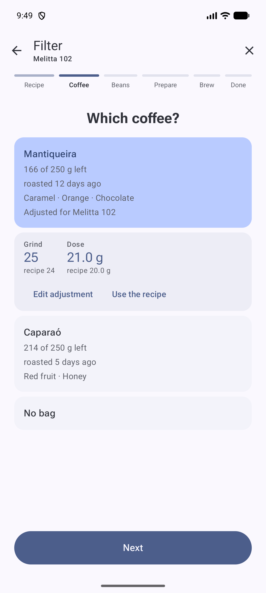 <b>Pick the coffee</b> Its grind, temperature and dose come with it. One tap brews as the recipe says instead.</td>
<td width="25%" align="center" valign="top">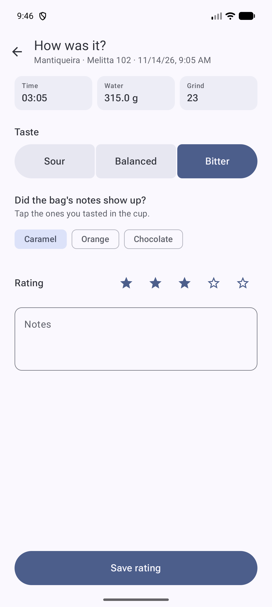 <b>Rate when you taste it</b> Sour, balanced or bitter, which of the bag's notes showed up, and a rating. A quiet reminder asks a few minutes after the brew.</td>
<td width="25%" align="center" valign="top">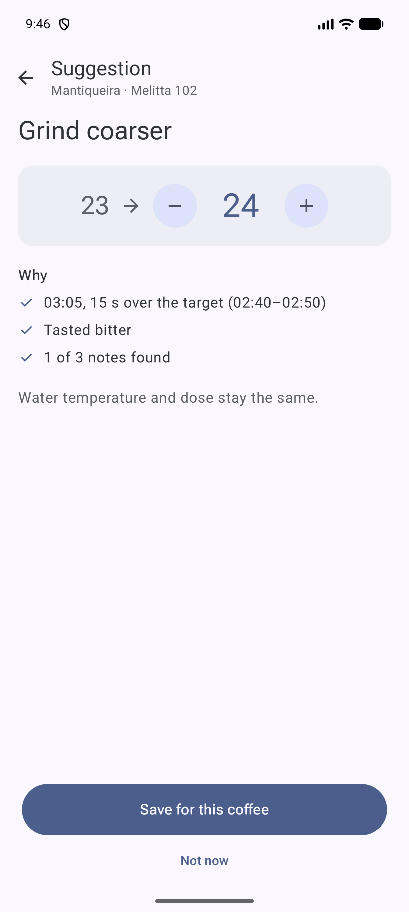 <b>Get one clear change</b> Grind or temperature, one step, with the reason. Save it for that coffee or leave it.</td>
<td width="25%" align="center" valign="top">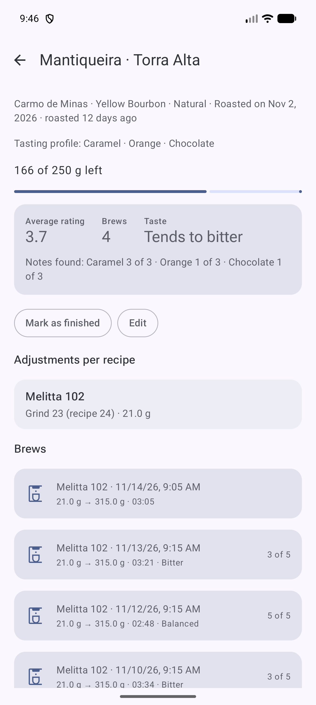 <b>See how it is going</b> Average rating, the taste it tends to, how often each note showed up, and its adjustments.</td>
</tr>
</table>

## Brew with a guide

<table>
<tr>
<td width="25%" align="center" valign="top">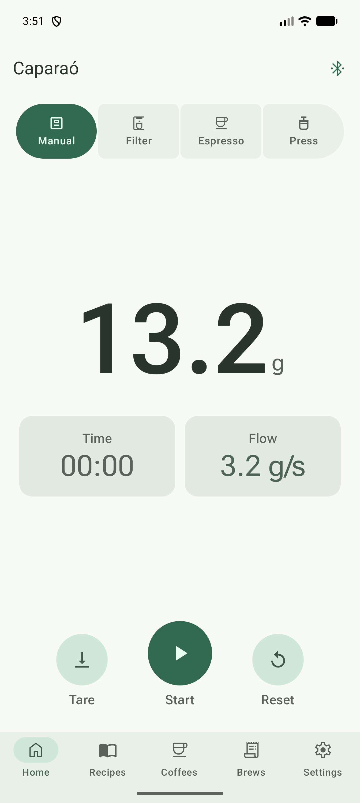 <b>Live scale</b> Weight, timer and flow in real time, with tare and timer controls.</td>
<td width="25%" align="center" valign="top">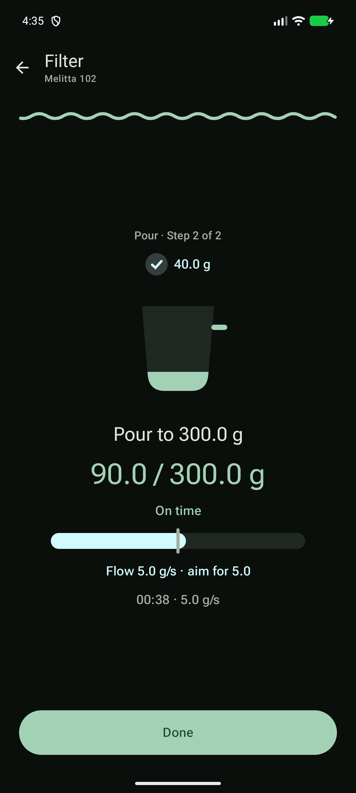 <b>Guided pours</b> Bloom, pours and waits by weight and time, with ahead or behind feedback and alerts.</td>
<td width="25%" align="center" valign="top">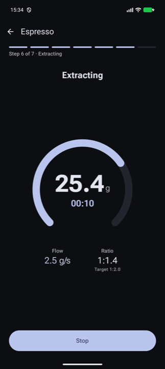 <b>Automatic espresso</b> Tares on the cup, starts on the first drop and stops when the flow does.</td>
<td width="25%" align="center" valign="top">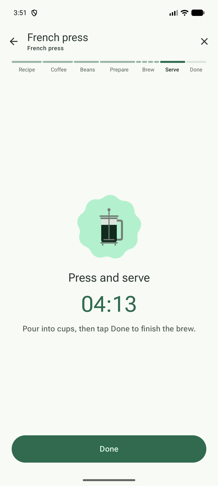 <b>French press</b> Water, steep timer and the press reminder, with a guided finish.</td>
</tr>
</table>

## Keep what works

<table>
<tr>
<td width="25%" align="center" valign="top">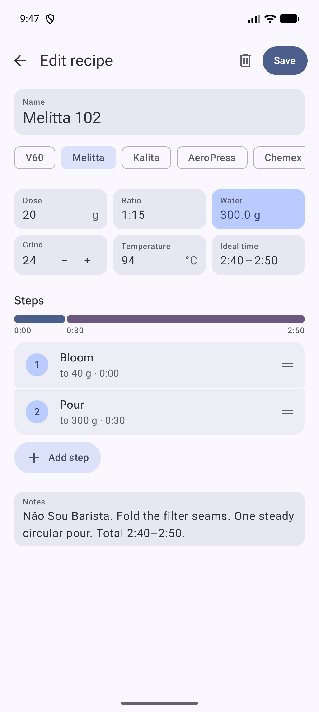 <b>Your recipes</b> Built-in espresso, V60, Melitta and French press recipes, and your own, with a timeline of the steps.</td>
<td width="25%" align="center" valign="top">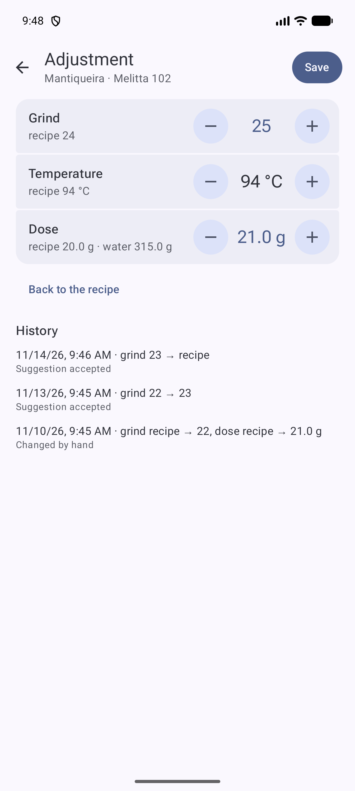 <b>Every change, explained</b> What each coffee changes in a recipe, and where each change came from.</td>
<td width="25%" align="center" valign="top">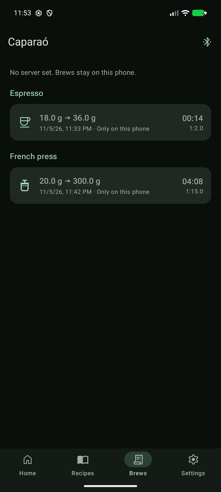 <b>Every brew</b> What is waiting for a rating first, then coffee, recipe, grind, taste and stars. Filter by coffee.</td>
<td width="25%" align="center" valign="top">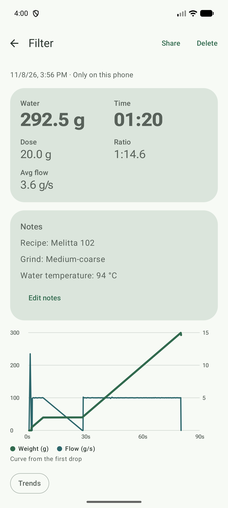 <b>Curves</b> Weight and flow curves for every brew.</td>
</tr>
</table>

## And also

- **On your wrist:** the Wear OS app mirrors the scale and the current pour, with the step, the pace, tare and timer
  buttons, a vibration on each step and a finish alert.
- **Coffee shelf:** bags with roaster, origin, roast date, what is left and a tasting profile. Roasters, origins and
  notes you used before are suggested as you type, and opening another bag of the same coffee brings its adjustments
  along.
- **Scale battery:** the Dot's battery percentage sits in the top bar while it is connected, and turns red at 20%.
- **Home-screen widget:** the last brew, with a shortcut to start the next one.
- **Offline first:** no account and no server. The rating reminder is a local notification.
- **Your data, your server:** optionally, each brew goes to any server that follows the
  [exporter's upload contract](https://github.com/MateuxLucax/timemore-dot-prometheus-exporter/blob/main/testdata/contract/README.md),
  such as [timemore-dot-prometheus-exporter](https://github.com/MateuxLucax/timemore-dot-prometheus-exporter), and from
  there to Prometheus and Grafana. Coffees, adjustments, taste and tasting notes never leave the phone.
- **Material 3 Expressive:** Roboto Flex and Material You colors, in light and dark.
- **Label reading:** Coffee bag photos and recognized text are processed on-device and deleted after reading. Google says ML Kit does not send inputs or results to its servers, but may contact Google for fixes, model updates and accelerator compatibility, and sends API performance and utilization metrics; see [ML Kit privacy terms](https://developers.google.com/ml-kit/terms).

The screens above are emulator captures with a scripted scale standing in for the Dot.

## Troubleshooting

| What you see | What to do |
|---|---|
| "Scale not found" | Turn the Dot on and bring it closer. It connects to one phone at a time: close the Timemore app or another phone using it. |
| "Scale won't pair" | The Dot remembers one phone. Hold its button (under the scale) until the light blinks fast, then tap Retry. |
| "Bluetooth not allowed" | App settings → Permissions → Nearby devices → Allow. |
| The espresso doesn't start | Put the cup down and leave it still for a second: the app tares, then waits for the first drops. If nothing happens after a few seconds, tap "Tare now". |
| The espresso doesn't end | It ends about 4 s after the weight stops rising. Tap Stop to end it yourself. |
| Brews stay "Only on this phone" | Brews tab shows the last upload error and its fix. Test the server in Settings. |
| Server on your home network times out | Android 17 needs the local network permission: allow it when the app asks, or in App settings → Permissions → Nearby devices. |
| "Wrong token" | The token in Settings must match the server's `AUTH_TOKEN`. |

The connection screen has **Copy debug log** for bug reports; it never contains the scale's address or name.

## Architecture

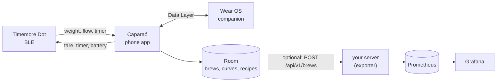

- **Kotlin, Jetpack Compose and Material 3**, one ViewModel per screen and manual dependency injection.
- **Layers, one way:** `model ← data ← brew ← sync ← ui`, enforced by a test.
  - `data`: the Dot's BLE protocol (frame decoder, CRC, handshake, reconnect with backoff), Room storage, the upload client.
  - `brew`: pure brew logic fed with timed readings: espresso and filter detectors, flow smoothing, French press
    finish tracking and recipe step tracking.
  - `sync`: WorkManager uploads with retries and readable errors.
  - `ui`: onboarding, home, guided brew, recipes, brews and settings.
- **Modules:** `app` (phone), `wear` (watch) and `wearlink` (shared watch snapshot).
- **Tested against real data:** detectors replay sessions recorded from a real Dot; screens are covered by Robolectric
  tests; `scripts/e2e.sh` runs the app against the pinned exporter on an emulator.

Decisions and pending work live in the [issues](https://github.com/MateuxLucax/caparao/issues), where every decision
lives.

## License

[MIT](LICENSE)
