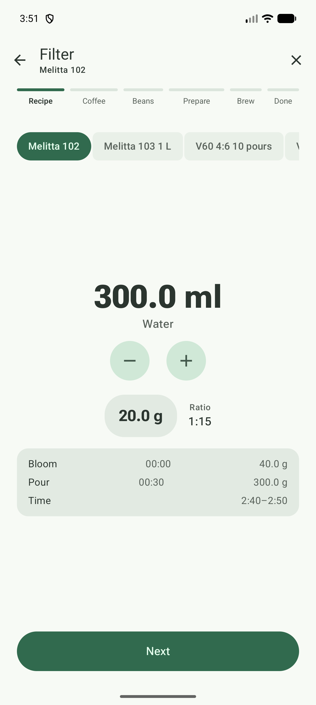
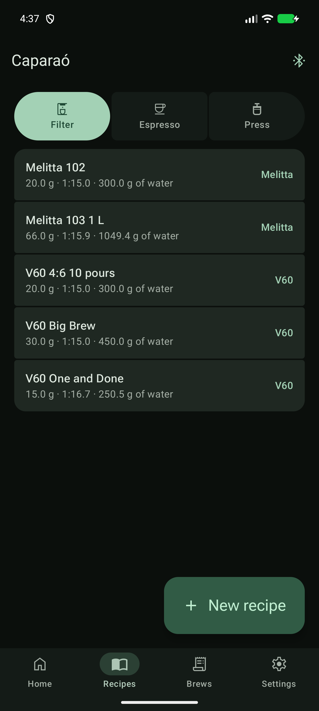
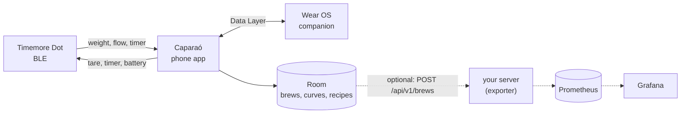

<h1 align="center">Caparaó</h1>

<p align="center">
  
  
  
</p>

A small, native Android app for the [Timemore Dot](https://www.timemore.com) coffee scale, with a Wear OS companion.
It shows weight, flow and timer live, guides espresso and filter recipes step by step, records every brew with its
curves and keeps everything on the phone. Optionally, each brew goes to your own server, and from there to Prometheus
and Grafana.

Personal, sideloaded app: no Play Store listing. English and Brazilian Portuguese. Android 12+, Wear OS 3+.

## Features

<table>
<tr>
<td width="33%" align="center"><br><b>Live scale</b><br>Weight, timer and flow in real time, with tare and timer controls.</td>
<td width="33%" align="center"><br><b>Dose and ratio</b><br>Pick the ratio, weigh the beans (auto tare) and the water follows.</td>
<td width="33%" align="center"><br><b>Guided pours</b><br>Bloom, pours and waits by weight and time, with ahead or behind feedback and alerts.</td>
</tr>
<tr>
<td align="center"><br><b>Automatic espresso</b><br>Tares on the cup, starts on the first drop and stops when the flow does.</td>
<td align="center"><br><b>History and charts</b><br>Weight and flow curves for every brew, compare two brews, trends per recipe.</td>
<td align="center"><br><b>Recipes</b><br>Built-in espresso, V60 and Melitta recipes, and your own with dose, ratio, grind, temperature and steps.</td>
</tr>
</table>

- **On the watch:** the Wear OS app mirrors the scale and the current pour, with the guided step and pace, tare and
  timer buttons, step vibration and a finish alert.
- **Coffee bags:** name, roaster, origin and process, roast date, weight, notes and a finished flag; the brew notes
  suggest open bags first.
- **Offline-first:** no account and no server needed. Sync is an add-on.
- **Your data:** brews go to any server that follows the [exporter's upload contract](https://github.com/MateuxLucax/timemore-dot-prometheus-exporter/blob/main/testdata/contract/README.md), such as
  [timemore-dot-prometheus-exporter](https://github.com/MateuxLucax/timemore-dot-prometheus-exporter).
- **Export:** recipes and brews as CSV, or brews as JSON in the upload format, in a zip through the share sheet.
- **Material 3 Expressive:** Roboto Flex, Material You colors or the Caparaó green, light and dark.

The screens above are emulator captures with a scripted scale standing in for the Dot.

## Architecture



- **Kotlin, Jetpack Compose and Material 3**, one ViewModel per screen and manual dependency injection.
- **Layers, one way:** `model ← data ← brew ← sync ← ui`, enforced by a test.
  - `data`: the Dot's BLE protocol (frame decoder, CRC, handshake, reconnect with backoff), Room storage, the upload client.
  - `brew`: pure brew logic fed with timed readings: espresso and filter detectors, flow smoothing, recipe step tracking.
  - `sync`: WorkManager uploads with retries and readable errors.
  - `ui`: onboarding, home, guided brew, recipes, brews and settings.
- **Modules:** `app` (phone), `wear` (watch) and `wearlink` (shared watch snapshot).
- **Tested against real data:** detectors replay sessions recorded from a real Dot; screens are covered by Robolectric
  tests; `scripts/e2e.sh` runs the app against the pinned exporter on an emulator.

Decisions and pending work live in the [issues](https://github.com/MateuxLucax/caparao/issues), where every decision
lives.

## Install

Download `caparao-<version>.apk` from [Releases](../../releases) and open it on the phone (allow installs from your
browser or file manager when Android asks). Each release lists the APK signer's SHA-256; to check it before
installing: `apksigner verify --print-certs caparao-<version>.apk`. Newer versions install over older ones and keep
your brews.

### Install on a Wear OS watch over Wi-Fi

Install GitHub CLI (`gh`) and Android platform-tools (`adb`), then connect the watch and computer to the same Wi-Fi. Enable Developer options and Wireless debugging on the watch. For first-time pairing, choose **Pair device with pairing code** in Wireless debugging and run `adb pair <watch-ip>:<pairing-port>`; enter the code when prompted. The pairing port differs from the connection port. Then use the connection port shown on the Wireless debugging screen:

```bash
scripts/install-watch.sh 192.0.2.10:37123
# or: scripts/install-watch.sh 192.0.2.10 37123
```

The script downloads the exact Wear APK from the latest published release and updates the app while preserving its data.

On first launch the app asks for **Nearby devices** (Bluetooth, only to find the scale), connects to the Dot, and
optionally asks for your server's URL and token.

## Troubleshooting

| What you see | What to do |
|---|---|
| "Scale not found" | Turn the Dot on and bring it closer. It connects to one phone at a time: close the Timemore app or another phone using it. |
| "Scale won't pair" | The Dot remembers one phone. Hold its button (under the scale) until the light blinks fast, then tap Retry. |
| "Bluetooth not allowed" | App settings → Permissions → Nearby devices → Allow. |
| The espresso doesn't start | Put the cup down and leave it still for a second: the app tares, then waits for the first drops. If the cup was already tared, tap "Cup already tared". |
| The espresso doesn't end | It ends about 4 s after the weight stops rising. Tap Stop to end it yourself. |
| Brews stay "Only on this phone" | Brews tab shows the last upload error and its fix. Test the server in Settings. |
| Server on your home network times out | Android 17 needs the local network permission: allow it when the app asks, or in App settings → Permissions → Nearby devices. |
| "Wrong token" | The token in Settings must match the server's `AUTH_TOKEN`. |

The connection screen has **Copy debug log** for bug reports; it never contains the scale's address or name.

## Development

JDK 17+ and the Android SDK (platform 37). On macOS with Android Studio installed:

```bash
echo "sdk.dir=$HOME/Library/Android/sdk" > local.properties
scripts/setup-hooks.sh   # secret scan before every commit (needs: brew install gitleaks)
scripts/check.sh         # JVM tests, lint, debug build and instrumented-test compilation
```

### Scripts

| Purpose | Entry point |
|---|---|
| Fast local and CI gate (tests, lint, debug build) | `scripts/check.sh` |
| Emulator end-to-end (replayed brews against the pinned exporter) | `scripts/e2e.sh` |
| Build and run the pinned development exporter | `scripts/exporter.sh` |
| Install the Wear OS app over Wi-Fi | `scripts/install-watch.sh` |
| Install git hooks and the secret scan | `scripts/setup-hooks.sh` |
| Create the release key, or build a signed release APK | `scripts/release-key.sh`, `scripts/release-apk.sh` |
| CI internals: emulator E2E wrapper and bounded, sanitized diagnostics | `scripts/ci/` (`e2e-ci.sh`, `e2e-diagnostics.py`) |
| Record a scale session and its Python dependencies | `scripts/capture/` (`capture-session.py`, `requirements-capture.txt`) |
| Capture scripted scale scenarios on an emulator | `scripts/capture/capture-scenarios.py` |
| Generate synthetic replay fixtures | `scripts/fixtures/` (`synthetic-session.py`, `synthetic-guide-sessions.py`) |
| Script tests | `scripts/tests/` |

Instrumented tests need an emulator or a phone: `./gradlew connectedDebugAndroidTest`. Debug builds can replay a recorded session instead of the scale
(the emulator has no Bluetooth):

```bash
adb shell am start -n io.github.mateuxlucax.caparao.debug/io.github.mateuxlucax.caparao.MainActivity --es replay press-ramp --el replay_at_ms 38300
```

The pinned real exporter is the development server. To run it directly, build it and start it with a disposable data
directory:

```bash
scripts/exporter.sh build
data_dir="$(mktemp -d)"
AUTH_TOKEN=dev-token EXPORTER_PORT=8099 scripts/exporter.sh start "$data_dir"
```

The debug-only scripted scale is controlled by a loopback HTTP API. It starts only when launched with `scripted_api`;
forward a host port to its `127.0.0.1` socket to use it:

```bash
adb shell am start -n io.github.mateuxlucax.caparao.debug/io.github.mateuxlucax.caparao.MainActivity --ez scripted_api true --ez script_paused true
adb forward tcp:18765 tcp:8765
curl -sS http://127.0.0.1:18765/state
curl -sS -X POST -H 'Content-Type: application/json' --data-binary @app/src/test/resources/scenarios/filter.json http://127.0.0.1:18765/scenario
curl -sS -X POST -H 'Content-Type: application/json' -d '{"event":"connection_failed","error":"NOT_FOUND"}' http://127.0.0.1:18765/event
curl -sS -X POST -H 'Content-Type: application/json' -d '{"event":"drop"}' http://127.0.0.1:18765/event
curl -sS -X POST -H 'Content-Type: application/json' -d '{"event":"overload","weight_g":1300}' http://127.0.0.1:18765/event
curl -sS -X POST -H 'Content-Type: application/json' -d '{"action":"pause"}' http://127.0.0.1:18765/clock
```

`/scenario` accepts JSON or CSV; `/reading` sends one weight sample; `/event` injects tare, connection_failed (with
an error), drop, overload or lift; `/clock`
pauses, advances or changes playback speed; `/state` returns the connection, reading and scenario position. To capture
the named checkpoints, attach `Pixel_10_Pro_XL`, set `ANDROID_SERIAL` to its emulator serial, then run
`scripts/capture/capture-scenarios.py`. It writes one PNG per state under the git-ignored `captures/scripted-scale/`.
Scenario JSON files live in `app/src/test/resources/scenarios/`; JVM and instrumented tests load those same files and
drive the virtual clock without HTTP.

`scripts/e2e.sh` starts its own exporter and replays espresso and French press sessions through the app on an emulator,
then checks the stored brews and curves. The canonical [upload contract](https://github.com/MateuxLucax/timemore-dot-prometheus-exporter/blob/main/testdata/contract/README.md)
lives with the exporter; change it there first, then bump the pin and update the app and its client fixtures.

Pull requests with build-relevant changes run Build checks and E2E (asset-, documentation- and license-only changes are
filtered out). A green Build on `main` triggers the release for that same commit; manual and `v*` tag releases run Build
and E2E before signing. Gitleaks runs locally when installed and is not part of CI.

Nothing secret lives in the repository: the server token is typed into the app. When installed, [gitleaks](https://github.com/gitleaks/gitleaks) runs from `scripts/check.sh` and the pre-commit hook.

## Server

Brews can be sent to [timemore-dot-prometheus-exporter](https://github.com/MateuxLucax/timemore-dot-prometheus-exporter),
which keeps them in SQLite and writes summaries and curves to Prometheus for Grafana. Any server that follows the
[upload contract](https://github.com/MateuxLucax/timemore-dot-prometheus-exporter/blob/main/testdata/contract/README.md) works.

## License

[MIT](LICENSE)
