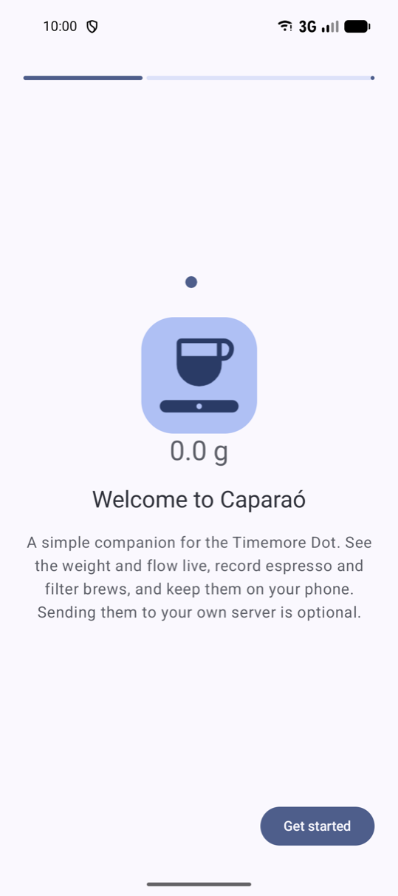
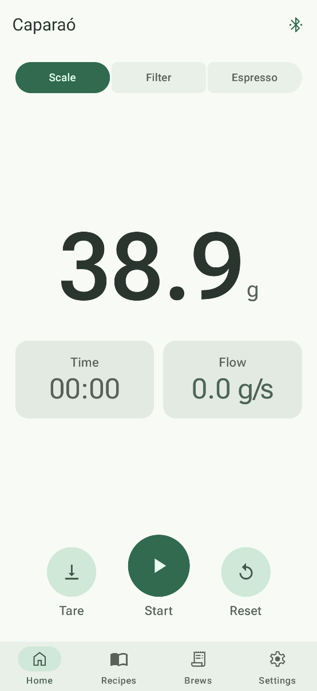
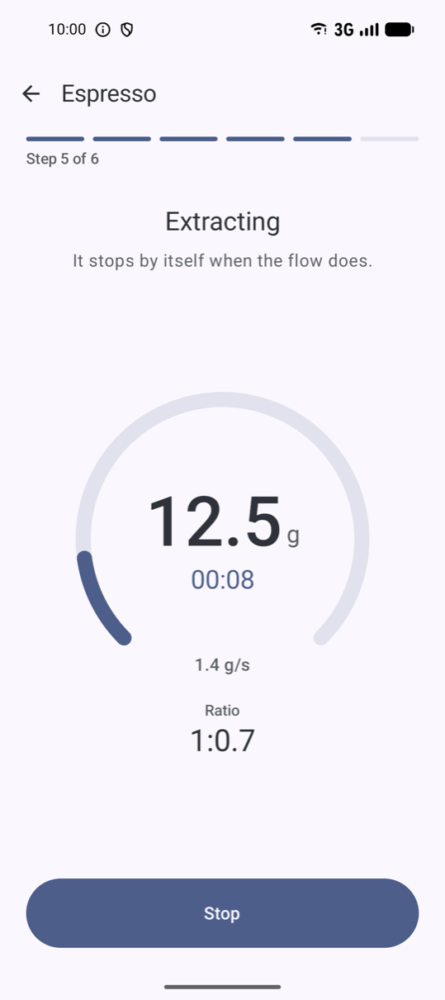
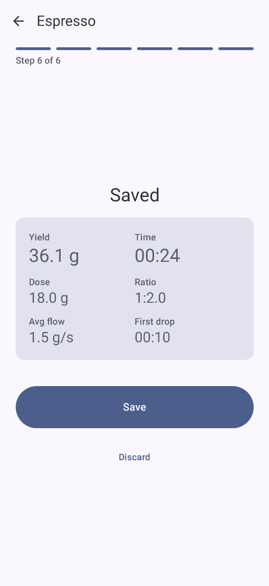
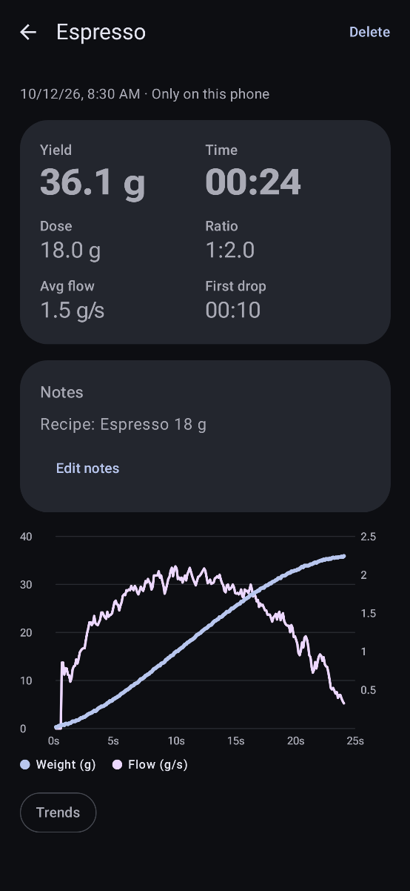
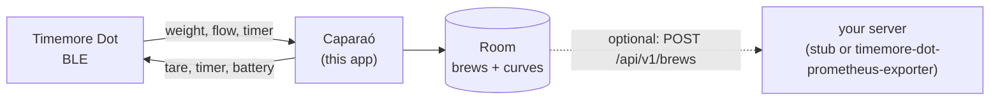

<h1 align="center">Caparaó</h1>

<p align="center">
  
  
  
</p>

A small, native Android app for the [Timemore Dot](https://www.timemore.com) coffee scale. It shows weight, flow and
battery live, records **automatic espresso** and **free-pour filter** brews, keeps everything on the phone and,
optionally, sends each brew to your own server.

**Offline-first:** the app works fully without a server. Exporting to a server (and from there to Prometheus and
Grafana) is an add-on, built last.

Personal, sideloaded app: no Play Store listing. English and Brazilian Portuguese. Android 12+.

> Status: stages 2–4 done in code: onboarding, live scale, automatic espresso and free-pour filter recording, saved
> brews with their curves. Device runs and sync to a server are next. See the [roadmap](docs/roadmap.md).

## Screenshots

<table>
<tr><th>Welcome</th><th>Home</th><th>Espresso, live</th><th>Saved</th><th>Brew detail</th></tr>
<tr>
<td></td>
<td></td>
<td></td>
<td></td>
<td></td>
</tr>
</table>

Taken on an emulator by `scripts/screenshots.sh`, with a session recorded from a real Dot (and a synthetic espresso)
standing in for the scale, and refreshed whenever a screen changes. The same set in Portuguese
and in dark theme is in [docs/screenshots](docs/screenshots/README.md).

## Architecture



Details in [docs/](docs/README.md): architecture, the Dot's BLE protocol, the upload contract and the
[ADRs](docs/adr/README.md).

## Install

Download `caparao-<version>.apk` from [Releases](../../releases) and open it on the phone (allow installs from your
browser or file manager when Android asks). Each release lists the APK signer's SHA-256; to check it before
installing: `apksigner verify --print-certs caparao-<version>.apk`. Newer versions install over older ones and keep
your brews.

On first launch the app asks for **Nearby devices** (Bluetooth, only to find the scale), connects to the Dot, and
optionally asks for your server's URL and token.

## Troubleshooting

| What you see | What to do |
|---|---|
| "Scale not found" | Turn the Dot on and bring it closer. It connects to one phone at a time: close the Timemore app or another phone using it. |
| "Scale won't pair" | The Dot remembers one phone. Hold its button (under the scale) until the light blinks fast, then tap Retry. |
| "Bluetooth not allowed" | App settings → Permissions → Nearby devices → Allow. |
| The espresso doesn't start | Put the cup down and leave it still for a second: the app tares, then waits for the first drops. If the cup was already tared, tap "Cup already tared". |
| The espresso doesn't end | It ends about 4 s after the weight stops rising. Tap Stop to end it yourself. |
| Brews stay "Only on this phone" | Brews tab shows the last upload error and its fix. Test the server in Settings. |
| Server on your home network times out | Android 17 needs the local network permission: allow it when the app asks, or in App settings → Permissions → Nearby devices. |
| "Wrong token" | The token in Settings must match the server's `AUTH_TOKEN`. |

The connection screen has **Copy debug log** for bug reports; it never contains the scale's address or name.

## Development

JDK 17+ and the Android SDK (platform 37). On macOS with Android Studio installed:

```bash
echo "sdk.dir=$HOME/Library/Android/sdk" > local.properties
scripts/setup-hooks.sh   # secret scan before every commit (needs: brew install gitleaks)
scripts/check.sh         # unit tests, lint, debug build, secret scan
```

Instrumented tests need an emulator or a phone: `./gradlew connectedDebugAndroidTest`. With an emulator running,
`scripts/screenshots.sh` refreshes the screenshots. Debug builds can replay a recorded session instead of the scale
(the emulator has no Bluetooth):

```bash
adb shell am start -n io.github.mateuxlucax.caparao/.MainActivity --es replay press-ramp --el replay_at_ms 38300
```

The stub server (`stub/`, Go) implements the upload [contract](contract/README.md) for development:
`cd stub && AUTH_TOKEN=dev-token go run .`. `scripts/e2e.sh` runs the whole chain on the emulator: a replayed
espresso is recorded, saved and uploaded to the stub, and the script checks what the stub received.
`E2E_SERVER=exporter scripts/e2e.sh` does the same against the real exporter (a sibling checkout) and Prometheus in
Docker. The stage 0 probe (`probe/`) records raw sessions from a real Dot; see
[docs/spike.md](docs/spike.md).

Nothing secret lives in the repository: release signing comes from environment variables, and the server token is
typed into the app. `scripts/check.sh` and the pre-commit hook run [gitleaks](https://github.com/gitleaks/gitleaks).

### Release signing

Releases come from the **Release** workflow (Actions tab, or push a `v*` tag; automatic once the repository is public)
and need the four signing secrets below; the workflow fails without them. Create a keystore once and keep it safe:
losing it means users must uninstall to update.

```bash
keytool -genkeypair -v -keystore release.jks -alias release -keyalg RSA -keysize 4096 -validity 10000
base64 -i release.jks | tr -d '\n' > release.jks.base64
```

| Repository secret | Value |
|---|---|
| `SIGNING_KEYSTORE_BASE64` | contents of `release.jks.base64` |
| `SIGNING_STORE_PASSWORD` | keystore password |
| `SIGNING_KEY_ALIAS` | `release` |
| `SIGNING_KEY_PASSWORD` | key password |

Never commit `release.jks`. Local release builds without the variables are signed with the debug key.

The code is one module with `model`, `data`, `brew`, `sync` and `ui` packages, manual dependency injection and one
ViewModel per screen, the same structure as
[health-connect-bridge](https://github.com/MateuxLucax/health-connect-bridge).

## Server

Brews can be sent to [timemore-dot-prometheus-exporter](https://github.com/MateuxLucax/timemore-dot-prometheus-exporter),
which keeps them in SQLite and writes the summaries and curves to Prometheus for Grafana. Any server that follows
[contract/](contract/README.md) works.

## License

[MIT](LICENSE)
