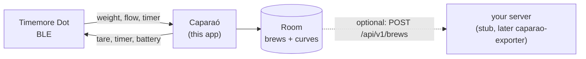

<h1 align="center">Caparaó</h1>

<p align="center">
  
  
  
</p>

A small, native Android app for the [Timemore Dot](https://www.timemore.com) coffee scale. It shows weight, flow and
battery live, records **automatic espresso** and **free-pour filter** brews, keeps everything on the phone and,
optionally, sends each brew to your own server.

**Offline-first:** the app works fully without a server. Exporting to a server (and from there to Prometheus and
Grafana) is an add-on, built last.

Personal, sideloaded app: no Play Store listing. English and Brazilian Portuguese. Android 12+.

> Status: stages 2–4 done in code: onboarding, live scale, automatic espresso and free-pour filter recording, saved
> brews with their curves. Device runs and sync to a server are next. See the [roadmap](docs/roadmap.md).

## Screenshots

<table>
<tr><th>Welcome</th><th>Home</th><th>Espresso, live</th><th>Saved</th><th>Brew detail</th></tr>
<tr>
<td></td>
<td></td>
<td></td>
<td></td>
<td></td>
</tr>
</table>

Taken on an emulator by `scripts/screenshots.sh`, with a session recorded from a real Dot (and a synthetic espresso)
standing in for the scale, and refreshed whenever a screen changes. The same set in Portuguese
and in dark theme is in [docs/screenshots](docs/screenshots/README.md).

## Architecture



Details in [docs/](docs/README.md): architecture, the Dot's BLE protocol, the upload contract and the
[ADRs](docs/adr/README.md).

## Development

JDK 17+ and the Android SDK (platform 37). On macOS with Android Studio installed:

```bash
echo "sdk.dir=$HOME/Library/Android/sdk" > local.properties
scripts/setup-hooks.sh   # secret scan before every commit (needs: brew install gitleaks)
scripts/check.sh         # unit tests, lint, debug build, secret scan
```

Instrumented tests need an emulator or a phone: `./gradlew connectedDebugAndroidTest`. With an emulator running,
`scripts/screenshots.sh` refreshes the screenshots. Debug builds can replay a recorded session instead of the scale
(the emulator has no Bluetooth):

```bash
adb shell am start -n io.github.mateuxlucax.caparao/.MainActivity --es replay press-ramp --el replay_at_ms 38300
```

The stub server (`stub/`, Go) implements the upload [contract](contract/README.md) for development:
`cd stub && AUTH_TOKEN=dev-token go run .`. The stage 0 probe (`probe/`) records raw sessions from a real Dot; see
[docs/spike.md](docs/spike.md).

Nothing secret lives in the repository: release signing comes from environment variables, and the server token is
typed into the app. `scripts/check.sh` and the pre-commit hook run [gitleaks](https://github.com/gitleaks/gitleaks).

The code is one module with `model`, `data`, `brew`, `sync` and `ui` packages, manual dependency injection and one
ViewModel per screen, the same structure as
[health-connect-bridge](https://github.com/MateuxLucax/health-connect-bridge).

## License

[MIT](LICENSE)
