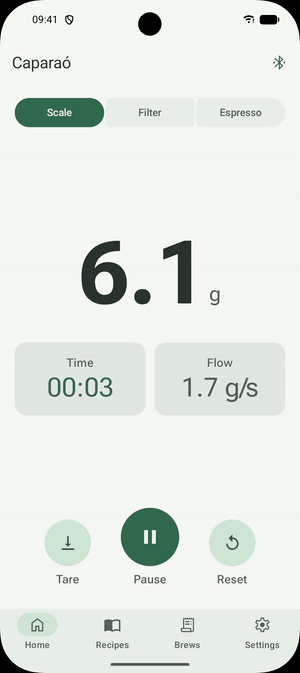
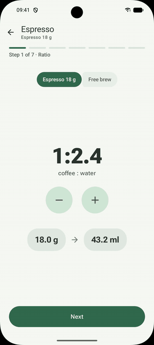
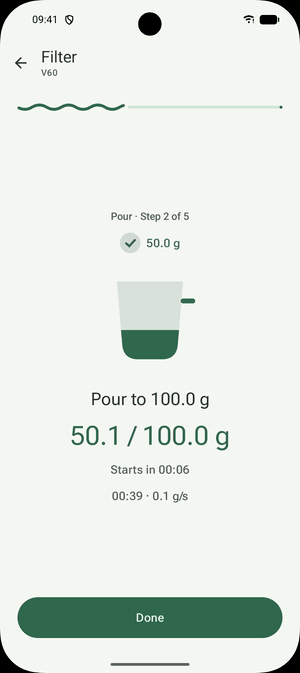
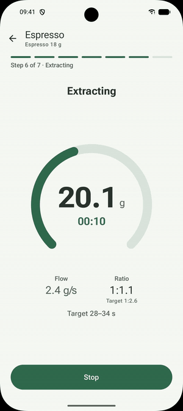
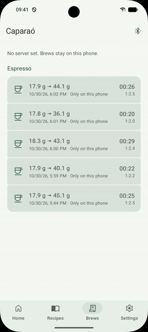
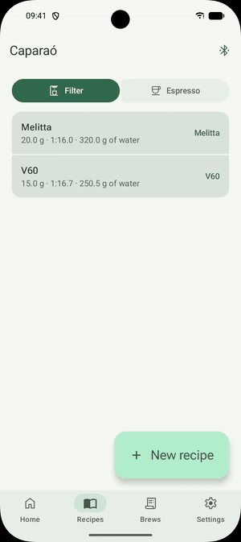
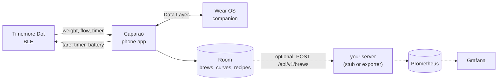

<h1 align="center">Caparaó</h1>

<p align="center">
  
  
  
</p>

A small, native Android app for the [Timemore Dot](https://www.timemore.com) coffee scale, with a Wear OS companion.
It shows weight, flow and timer live, guides espresso and filter recipes step by step, records every brew with its
curves and keeps everything on the phone. Optionally, each brew goes to your own server, and from there to Prometheus
and Grafana.

<p align="center"><a href="docs/promo.mp4"></a></p>

Personal, sideloaded app: no Play Store listing. English and Brazilian Portuguese. Android 12+, Wear OS 3+.

## Features

<table>
<tr>
<td width="33%" align="center"><br><b>Live scale</b><br>Weight, timer and flow in real time, with tare and timer controls.</td>
<td width="33%" align="center"><br><b>Dose and ratio</b><br>Pick the ratio, weigh the beans (auto tare) and the water follows.</td>
<td width="33%" align="center"><br><b>Guided pours</b><br>Bloom, pours and waits by weight and time, with ahead or behind feedback and alerts.</td>
</tr>
<tr>
<td align="center"><br><b>Automatic espresso</b><br>Tares on the cup, starts on the first drop and stops when the flow does.</td>
<td align="center"><br><b>History and charts</b><br>Weight and flow curves for every brew, compare two brews, trends per recipe.</td>
<td align="center"><br><b>Recipes</b><br>Built-in espresso, V60 and Melitta recipes, and your own with dose, ratio, grind, temperature and steps.</td>
</tr>
</table>

- **On the watch:** the Wear OS app mirrors the scale and the current pour, with tare and timer buttons.
- **Offline-first:** no account and no server needed. Sync is an add-on.
- **Your data:** brews go to any server that follows the [contract](contract/README.md), such as
  [timemore-dot-prometheus-exporter](https://github.com/MateuxLucax/timemore-dot-prometheus-exporter).
- **Material 3 Expressive:** Roboto Flex, Material You colors or the Caparaó green, light and dark.

The clips above are real recordings from the emulator, with a replayed scale session standing in for the Dot; the
full-length MP4s are in [docs/demo](docs/demo). Static screenshots of every screen, in English and Portuguese, light and
dark, are in [docs/screenshots](docs/screenshots/README.md), rendered on the JVM by `scripts/screenshots.sh`.

## Architecture



- **Kotlin, Jetpack Compose and Material 3**, one ViewModel per screen and manual dependency injection.
- **Layers, one way:** `model ← data ← brew ← sync ← ui`, enforced by a test.
  - `data`: the Dot's BLE protocol (frame decoder, CRC, handshake, reconnect with backoff), Room storage, the upload client.
  - `brew`: pure brew logic fed with timed readings: espresso and filter detectors, flow smoothing, recipe step tracking.
  - `sync`: WorkManager uploads with retries and readable errors.
  - `ui`: onboarding, home, guided brew, recipes, brews and settings.
- **Modules:** `app` (phone), `wear` (watch), `wearlink` (shared watch snapshot), `stub` (Go dev server), `contract`
  (upload schema), `probe` (raw BLE recorder).
- **Tested against real data:** detectors replay sessions recorded from a real Dot; screens are covered by Robolectric
  tests and Roborazzi screenshots; `scripts/e2e.sh` runs scale, app and server end to end on the emulator.

More in [docs/](docs/README.md): [architecture](docs/architecture.md), the Dot's [BLE protocol](docs/hardware.md),
the [roadmap](docs/roadmap.md) and the [ADRs](docs/adr/README.md).

## Install

Download `caparao-<version>.apk` from [Releases](../../releases) and open it on the phone (allow installs from your
browser or file manager when Android asks). Each release lists the APK signer's SHA-256; to check it before
installing: `apksigner verify --print-certs caparao-<version>.apk`. Newer versions install over older ones and keep
your brews.

On first launch the app asks for **Nearby devices** (Bluetooth, only to find the scale), connects to the Dot, and
optionally asks for your server's URL and token.

## Troubleshooting

| What you see | What to do |
|---|---|
| "Scale not found" | Turn the Dot on and bring it closer. It connects to one phone at a time: close the Timemore app or another phone using it. |
| "Scale won't pair" | The Dot remembers one phone. Hold its button (under the scale) until the light blinks fast, then tap Retry. |
| "Bluetooth not allowed" | App settings → Permissions → Nearby devices → Allow. |
| The espresso doesn't start | Put the cup down and leave it still for a second: the app tares, then waits for the first drops. If the cup was already tared, tap "Cup already tared". |
| The espresso doesn't end | It ends about 4 s after the weight stops rising. Tap Stop to end it yourself. |
| Brews stay "Only on this phone" | Brews tab shows the last upload error and its fix. Test the server in Settings. |
| Server on your home network times out | Android 17 needs the local network permission: allow it when the app asks, or in App settings → Permissions → Nearby devices. |
| "Wrong token" | The token in Settings must match the server's `AUTH_TOKEN`. |

The connection screen has **Copy debug log** for bug reports; it never contains the scale's address or name.

## Development

JDK 17+ and the Android SDK (platform 37). On macOS with Android Studio installed:

```bash
echo "sdk.dir=$HOME/Library/Android/sdk" > local.properties
scripts/setup-hooks.sh   # secret scan before every commit (needs: brew install gitleaks)
scripts/check.sh         # unit tests, lint, debug build, secret scan
```

`scripts/screenshots.sh` refreshes the screenshots on the JVM, no emulator needed (`ONLY=Espresso` renders one test).
Instrumented tests need an emulator or a phone: `./gradlew connectedDebugAndroidTest`. Debug builds can replay a recorded session instead of the scale
(the emulator has no Bluetooth):

```bash
adb shell am start -n io.github.mateuxlucax.caparao.debug/io.github.mateuxlucax.caparao.MainActivity --es replay press-ramp --el replay_at_ms 38300
```

The stub server (`stub/`, Go) implements the upload [contract](contract/README.md) for development:
`cd stub && AUTH_TOKEN=dev-token go run .`. `scripts/e2e.sh` runs the whole chain on the emulator: a replayed
espresso is recorded, saved and uploaded to the stub, and the script checks what the stub received.
`E2E_SERVER=exporter scripts/e2e.sh` does the same against the real exporter (a sibling checkout) and Prometheus in
Docker. The stage 0 probe (`probe/`) records raw sessions from a real Dot; see
[docs/spike.md](docs/spike.md).

Nothing secret lives in the repository: the server token is typed into the app. `scripts/check.sh` and the pre-commit hook run [gitleaks](https://github.com/gitleaks/gitleaks).

## Server

Brews can be sent to [timemore-dot-prometheus-exporter](https://github.com/MateuxLucax/timemore-dot-prometheus-exporter),
which keeps them in SQLite and writes the summaries and curves to Prometheus for Grafana. Any server that follows
[contract/](contract/README.md) works.

## License

[MIT](LICENSE)
