<h1 align="center">Caparaó</h1>

<p align="center">
  
  
  
</p>

<p align="center"><b>Brew better coffee with the scale you already have.</b></p>

Caparaó turns the [Timemore Dot](https://www.timemore.com) into a brewing guide. It walks you through espresso, filter
and French press by weight and time, remembers what each coffee needs, and tells you what to change after you taste
the cup. No account and no ads; your brews stay on your phone unless you connect your own server.

<p align="center">
  <b>Android 12+ · Wear OS 3+ · English and Brazilian Portuguese</b><br>
  On Google Play and as signed APKs in <a href="../../releases">Releases</a> · <a href="PRIVACY.md">Privacy policy</a>
</p>

## Dial in every coffee

A new bag rarely brews like the last one. Caparaó keeps the grind, water temperature and dose that work for each
coffee in each recipe, and moves them one step at a time from what you tasted.

<table>
<tr>
<td width="25%" align="center" valign="top">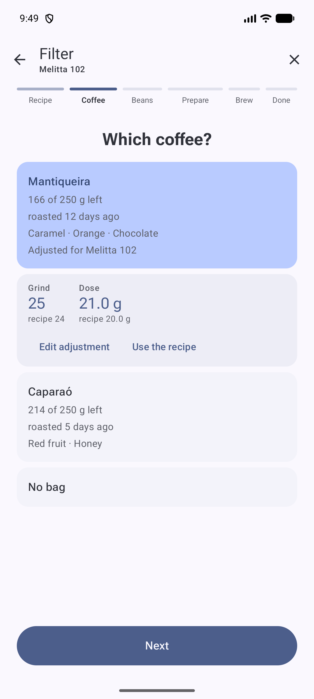<br><b>Pick the coffee</b><br>Its grind, temperature and dose come with it. One tap brews as the recipe says instead.</td>
<td width="25%" align="center" valign="top">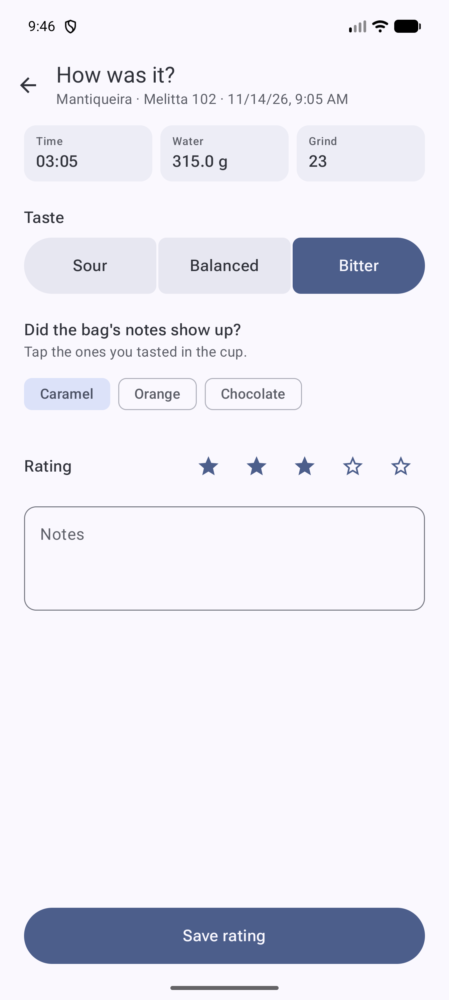<br><b>Rate when you taste it</b><br>Sour, balanced or bitter, which of the bag's notes showed up, and a rating. A quiet reminder asks a few minutes after the brew.</td>
<td width="25%" align="center" valign="top">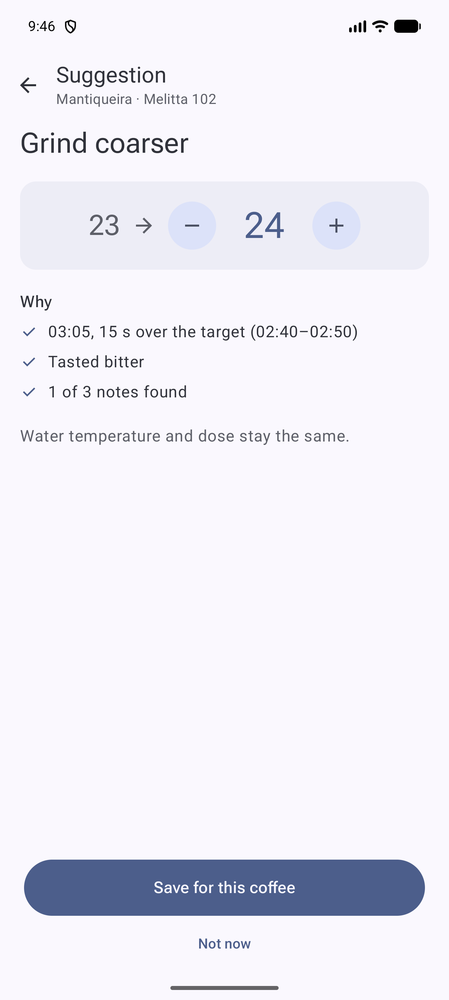<br><b>Get one clear change</b><br>Grind or temperature, one step, with the reason. Save it for that coffee or leave it.</td>
<td width="25%" align="center" valign="top">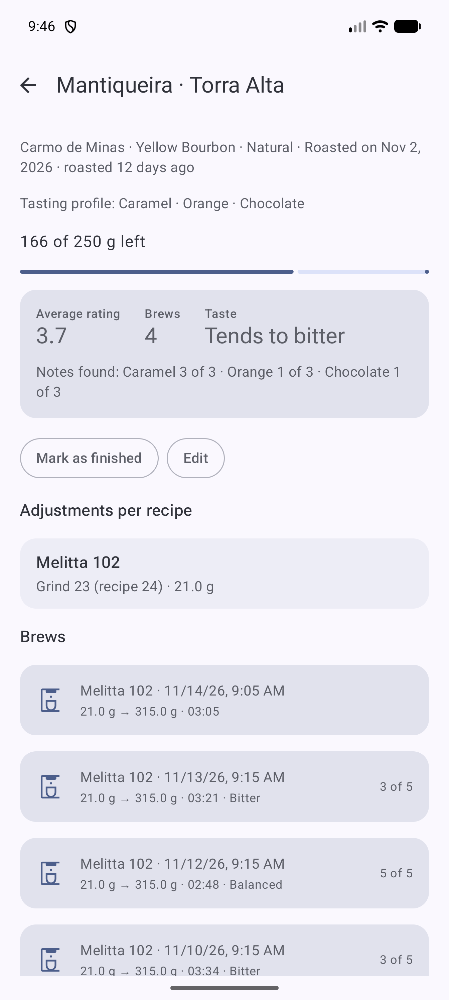<br><b>See how it is going</b><br>Average rating, the taste it tends to, how often each note showed up, and its adjustments.</td>
</tr>
</table>

## Brew with a guide

<table>
<tr>
<td width="25%" align="center" valign="top">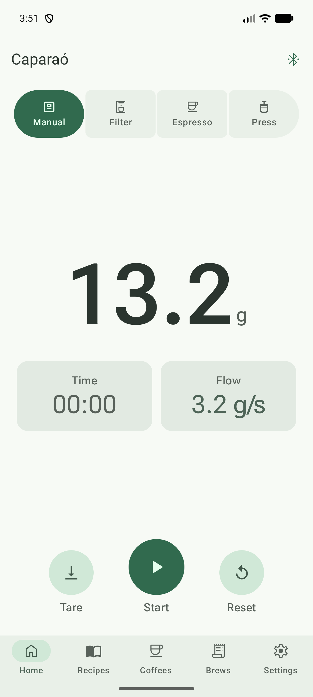<br><b>Live scale</b><br>Weight, timer and flow in real time, with tare and timer controls.</td>
<td width="25%" align="center" valign="top">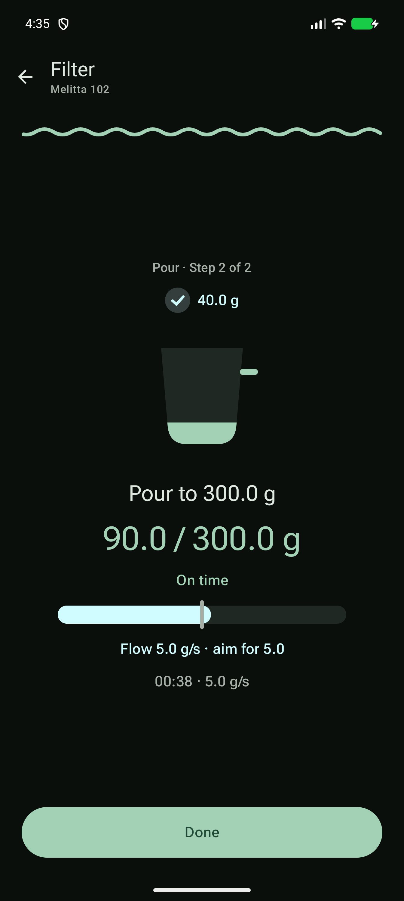<br><b>Guided pours</b><br>Bloom, pours and waits by weight and time, with ahead or behind feedback and alerts.</td>
<td width="25%" align="center" valign="top">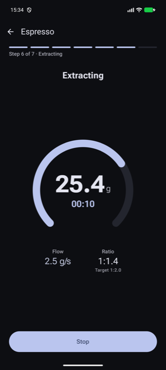<br><b>Automatic espresso</b><br>Tares on the cup, starts on the first drop and stops when the flow does.</td>
<td width="25%" align="center" valign="top">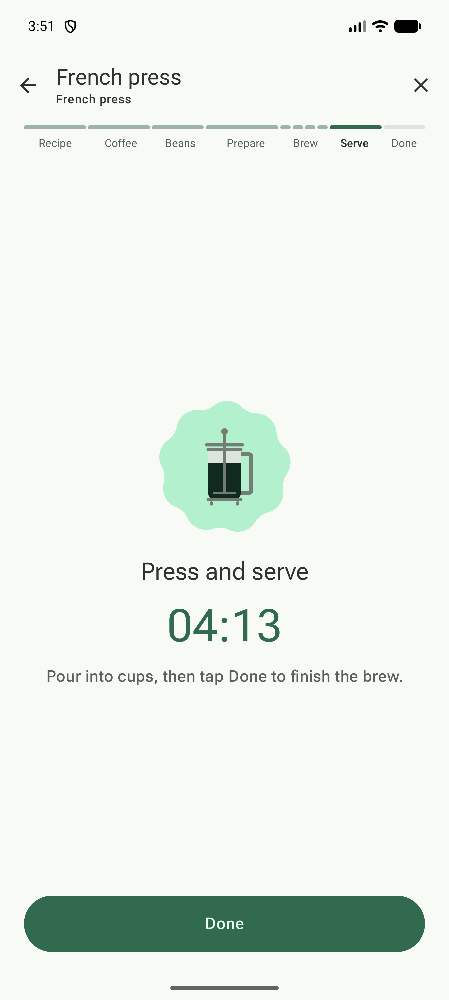<br><b>French press</b><br>Water, steep timer and the press reminder, with a guided finish.</td>
</tr>
</table>

## Keep what works

<table>
<tr>
<td width="25%" align="center" valign="top">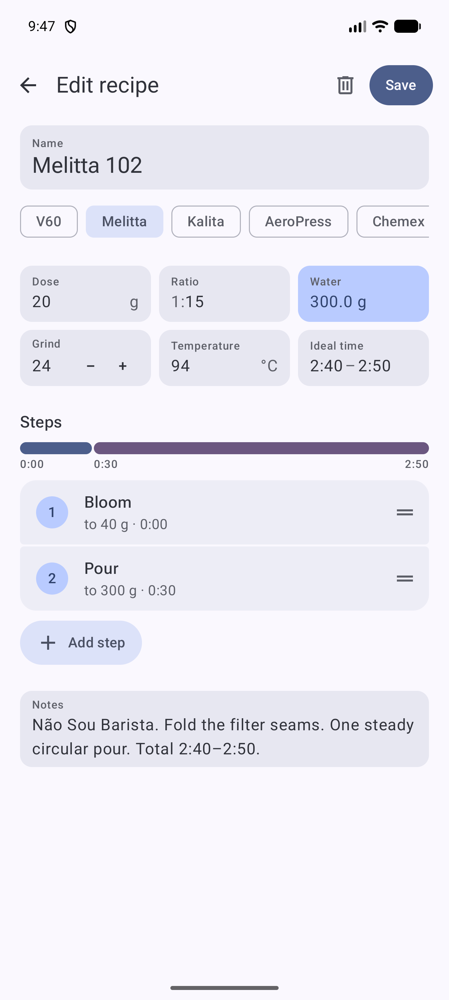<br><b>Your recipes</b><br>Built-in espresso, V60, Melitta and French press recipes, and your own, with a timeline of the steps.</td>
<td width="25%" align="center" valign="top">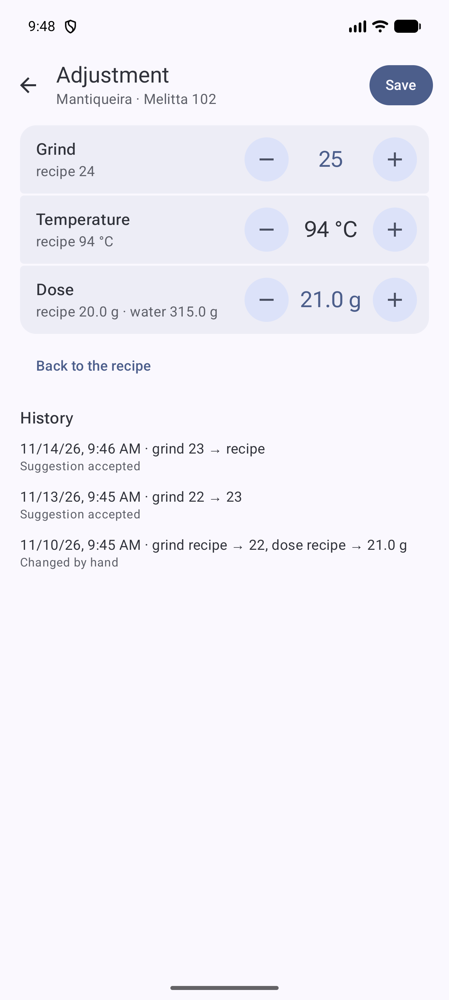<br><b>Every change, explained</b><br>What each coffee changes in a recipe, and where each change came from.</td>
<td width="25%" align="center" valign="top">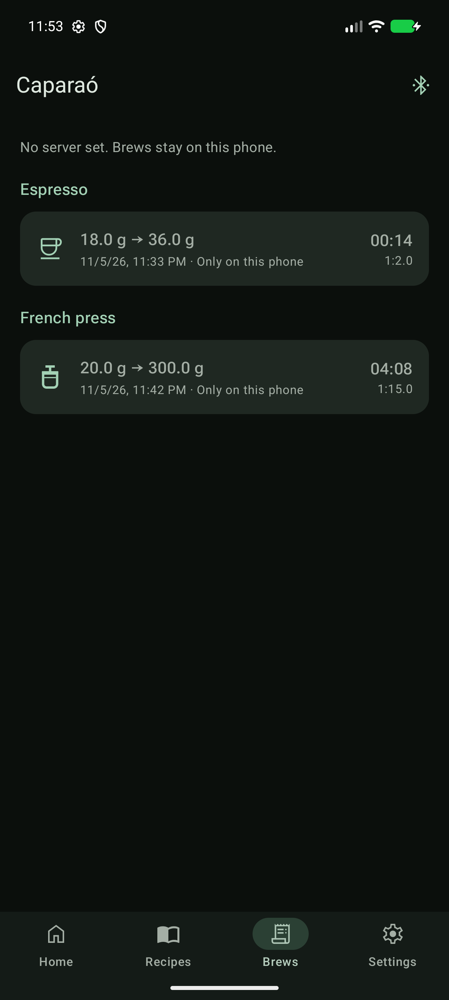<br><b>Every brew</b><br>What is waiting for a rating first, then coffee, recipe, grind, taste and stars. Filter by coffee.</td>
<td width="25%" align="center" valign="top">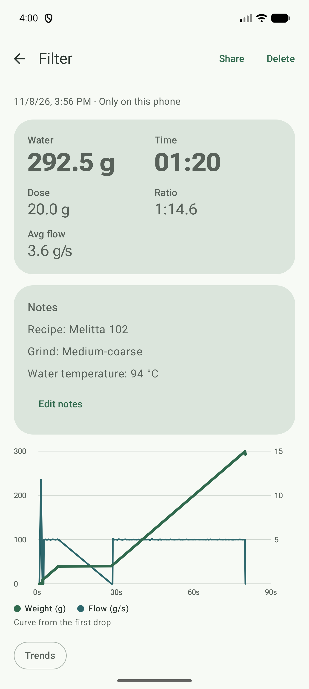<br><b>Curves</b><br>Weight and flow curves for every brew.</td>
</tr>
</table>

## And also

- **On your wrist:** the Wear OS app mirrors the scale and the current pour, with the step, the pace, tare and timer
  buttons, a vibration on each step and a finish alert.
- **Coffee shelf:** bags with roaster, origin, roast date, what is left and a tasting profile.
- **Home-screen widget:** the last brew, with a shortcut to start the next one.
- **Offline first:** no account and no server. The rating reminder is a local notification.
- **Your data, your server:** optionally, each brew goes to any server that follows the
  [exporter's upload contract](https://github.com/MateuxLucax/timemore-dot-prometheus-exporter/blob/main/testdata/contract/README.md),
  such as [timemore-dot-prometheus-exporter](https://github.com/MateuxLucax/timemore-dot-prometheus-exporter), and from
  there to Prometheus and Grafana. Coffees, adjustments, taste and tasting notes never leave the phone.
- **Material 3 Expressive:** Roboto Flex and Material You colors, in light and dark.

The screens above are emulator captures with a scripted scale standing in for the Dot.

## Install

Download `caparao-<version>.apk` from [Releases](../../releases) and open it on the phone (allow installs from your
browser or file manager when Android asks). Each release lists the APK signer's SHA-256; to check it before
installing: `apksigner verify --print-certs caparao-<version>.apk`. Newer versions install over older ones and keep
your brews. The app id is `dev.mateux.caparao`.

### Install on a Wear OS watch over Wi-Fi

Install GitHub CLI (`gh`) and Android platform-tools (`adb`), then connect the watch and computer to the same Wi-Fi. Enable Developer options and Wireless debugging on the watch. For first-time pairing, choose **Pair device with pairing code** in Wireless debugging and run `adb pair <watch-ip>:<pairing-port>`; enter the code when prompted. The pairing port differs from the connection port. Then use the connection port shown on the Wireless debugging screen:

```bash
scripts/install-watch.sh 192.0.2.10:37123
# or: scripts/install-watch.sh 192.0.2.10 37123
```

The script downloads the exact Wear APK from the latest published release and updates the app while preserving its data.

On first launch the app asks for **Nearby devices** (Bluetooth, only to find the scale), connects to the Dot, and
optionally asks for your server's URL and token.

## Troubleshooting

| What you see | What to do |
|---|---|
| "Scale not found" | Turn the Dot on and bring it closer. It connects to one phone at a time: close the Timemore app or another phone using it. |
| "Scale won't pair" | The Dot remembers one phone. Hold its button (under the scale) until the light blinks fast, then tap Retry. |
| "Bluetooth not allowed" | App settings → Permissions → Nearby devices → Allow. |
| The espresso doesn't start | Put the cup down and leave it still for a second: the app tares, then waits for the first drops. If nothing happens after a few seconds, tap "Tare now". |
| The espresso doesn't end | It ends about 4 s after the weight stops rising. Tap Stop to end it yourself. |
| Brews stay "Only on this phone" | Brews tab shows the last upload error and its fix. Test the server in Settings. |
| Server on your home network times out | Android 17 needs the local network permission: allow it when the app asks, or in App settings → Permissions → Nearby devices. |
| "Wrong token" | The token in Settings must match the server's `AUTH_TOKEN`. |

The connection screen has **Copy debug log** for bug reports; it never contains the scale's address or name.

## Architecture

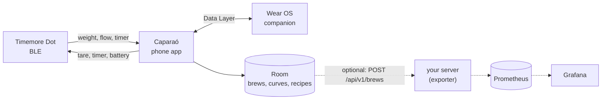

- **Kotlin, Jetpack Compose and Material 3**, one ViewModel per screen and manual dependency injection.
- **Layers, one way:** `model ← data ← brew ← sync ← ui`, enforced by a test.
  - `data`: the Dot's BLE protocol (frame decoder, CRC, handshake, reconnect with backoff), Room storage, the upload client.
  - `brew`: pure brew logic fed with timed readings: espresso and filter detectors, flow smoothing, French press
    finish tracking and recipe step tracking.
  - `sync`: WorkManager uploads with retries and readable errors.
  - `ui`: onboarding, home, guided brew, recipes, brews and settings.
- **Modules:** `app` (phone), `wear` (watch) and `wearlink` (shared watch snapshot).
- **Tested against real data:** detectors replay sessions recorded from a real Dot; screens are covered by Robolectric
  tests; `scripts/e2e.sh` runs the app against the pinned exporter on an emulator.

Decisions and pending work live in the [issues](https://github.com/MateuxLucax/caparao/issues), where every decision
lives.

## Development

JDK 17+ and the Android SDK (platform 37). On macOS with Android Studio installed:

```bash
echo "sdk.dir=$HOME/Library/Android/sdk" > local.properties
scripts/setup-hooks.sh   # secret scan before every commit (needs: brew install gitleaks)
scripts/check.sh         # JVM tests, lint, debug build and instrumented-test compilation
```

### Scripts

| Purpose | Entry point |
|---|---|
| Fast local and CI gate (tests, lint, debug build) | `scripts/check.sh` |
| Emulator end-to-end (replayed brews against the pinned exporter) | `scripts/e2e.sh` |
| Build and run the pinned development exporter | `scripts/exporter.sh` |
| Install the Wear OS app over Wi-Fi | `scripts/install-watch.sh` |
| Install git hooks and the secret scan | `scripts/setup-hooks.sh` |
| Create the release key, or build a signed release APK | `scripts/release-key.sh`, `scripts/release-apk.sh` |
| CI internals: emulator E2E wrapper, bounded, sanitized diagnostics and the PR description check | `scripts/ci/` (`e2e-ci.sh`, `e2e-diagnostics.py`, `pr-template-check.py`) |
| Record a scale session and its Python dependencies | `scripts/capture/` (`capture-session.py`, `requirements-capture.txt`) |
| Fetch a Sentry capture and convert it to replay JSONL | `scripts/capture/fetch-capture.py` |
| Capture scripted scale scenarios on an emulator | `scripts/capture/capture-scenarios.py` |
| Generate synthetic replay fixtures | `scripts/fixtures/` (`synthetic-session.py`, `synthetic-guide-sessions.py`) |
| Script tests | `scripts/tests/` |

With diagnostics enabled, you can capture only the next brew or turn on **Capture every brew** in Settings. Captures include only scale weight, battery and
acknowledgement frames, successful app commands, and fixed app events; the uploaded recording includes the phone model,
Android version and app version, but omits scale identifiers and user-entered data. They stay in app-private storage
while offline and are removed after Sentry confirms delivery, when consent is turned off, or after 7 days. The release
Sentry DSN is supplied by CI; public documentation uses `https://public@o0.ingest.sentry.io/0`.
To rebuild a fixture from an event, set `SENTRY_AUTH_TOKEN` in the shell and run
`python3 scripts/capture/fetch-capture.py <event-id> --org <org> --project <project>`. The script validates the capture
and writes replay JSONL under the ignored `spike-captures/` directory by default.

### Dependency verification

Gradle checks every plugin and library it downloads against `gradle/verification-metadata.xml`: PGP signatures where
the publisher signs, SHA-256 checksums otherwise. The public keys are in `gradle/verification-keyring.keys`, so a build
does not depend on key servers, and `-sources`/`-javadoc` jars are trusted so Android Studio sync works. Build, E2E and
Release all verify the same metadata.

After a dependency bump (manual or Dependabot, #314), refresh the metadata in the same PR and commit both files:

```bash
./gradlew --write-verification-metadata pgp,sha256 --export-keys \
  help assembleRelease testDebugUnitTest lint assembleDebug assembleDebugAndroidTest \
  :wear:testDebugUnitTest :wearlink:test compileDebugAndroidTestKotlin
```

Review the diff: remove entries for versions no longer used and remove any `version` attribute from new `trusted-key`
entries, so a key covers the library's future versions. If Gradle reports a key it cannot download, retry with
`--refresh-keys` or add the key to `gradle/verification-keyring.keys`; leave an `ignored-key` only when the key is not
published anywhere.

Instrumented tests need an emulator or a phone: `./gradlew connectedDebugAndroidTest`. Debug builds can replay a recorded session instead of the scale
(the emulator has no Bluetooth):

```bash
adb shell am start -n dev.mateux.caparao.debug/dev.mateux.caparao.ui.MainActivity --es replay press-ramp --el replay_at_ms 38300
```

The pinned real exporter is the development server. To run it directly, build it and start it with a disposable data
directory:

```bash
scripts/exporter.sh build
data_dir="$(mktemp -d)"
AUTH_TOKEN=dev-token EXPORTER_PORT=8099 scripts/exporter.sh start "$data_dir"
```

The debug-only scripted scale is controlled by a loopback HTTP API. It starts only when launched with `scripted_api`;
forward a host port to its `127.0.0.1` socket to use it:

```bash
adb shell am start -n dev.mateux.caparao.debug/dev.mateux.caparao.ui.MainActivity --ez scripted_api true --ez script_paused true
adb forward tcp:18765 tcp:8765
curl -sS http://127.0.0.1:18765/state
curl -sS -X POST -H 'Content-Type: application/json' --data-binary @app/src/test/resources/scenarios/filter.json http://127.0.0.1:18765/scenario
curl -sS -X POST -H 'Content-Type: application/json' -d '{"event":"connection_failed","error":"NOT_FOUND"}' http://127.0.0.1:18765/event
curl -sS -X POST -H 'Content-Type: application/json' -d '{"event":"drop"}' http://127.0.0.1:18765/event
curl -sS -X POST -H 'Content-Type: application/json' -d '{"event":"overload","weight_g":1300}' http://127.0.0.1:18765/event
curl -sS -X POST -H 'Content-Type: application/json' -d '{"action":"pause"}' http://127.0.0.1:18765/clock
```

`/scenario` accepts JSON or CSV; `/reading` sends one weight sample; `/event` injects tare, connection_failed (with
an error), drop, overload or lift; `/clock`
pauses, advances or changes playback speed; `/state` returns the connection, reading and scenario position. To capture
the named checkpoints, attach `Pixel_10_Pro_XL`, set `ANDROID_SERIAL` to its emulator serial, then run
`scripts/capture/capture-scenarios.py`. It writes one PNG per state under the git-ignored `captures/scripted-scale/`.
The README screens come from these states, plus the saved-brew and recipe screens captured after a run.
Scenario JSON files live in `app/src/test/resources/scenarios/`; JVM and instrumented tests load those same files and
drive the virtual clock without HTTP.

### Baseline Profile and Macrobenchmark

The release APK carries a Baseline Profile generated from three journeys (#312): cold start to Home, a filter brew with
the scripted scale through its live screen, and the Brews list scrolled into a brew detail. The `:baselineprofile` and
`:macrobenchmark` modules are `com.android.test` targets: they run on an emulator or device and are not part of
`scripts/check.sh` or the release build.

Attach the emulator (`Pixel_10_Pro_XL`), set `ANDROID_SERIAL`, and generate the profile:

```bash
./gradlew :app:generateReleaseBaselineProfile
```

The generator writes `baseline-prof.txt` and `startup-prof.txt` under
`app/src/release/generated/baselineProfiles/`; commit both with the change. The release APK contains the compiled
profile at `assets/dexopt/baseline.prof`, and `profileinstaller` installs it on sideloaded builds. Measure the result
on the same device (each journey runs with `CompilationMode.None` and with the profile):

```bash
./gradlew :macrobenchmark:connectedBenchmarkReleaseAndroidTest \
  -Pandroid.testInstrumentationRunnerArguments.class=dev.mateux.caparao.macrobenchmark.StartupBenchmark
./gradlew :macrobenchmark:connectedBenchmarkReleaseAndroidTest \
  -Pandroid.testInstrumentationRunnerArguments.class=dev.mateux.caparao.macrobenchmark.BrewBenchmarks
```

Both benchmark variants use the debug signing key and stay off release builds; they carry the scripted scale and a
seeded Brews list so the journeys do not depend on the phone's data.

`scripts/e2e.sh` starts its own exporter and replays espresso and French press sessions through the app on an emulator,
then checks the stored brews and curves. The canonical [upload contract](https://github.com/MateuxLucax/timemore-dot-prometheus-exporter/blob/main/testdata/contract/README.md)
lives with the exporter; change it there first, then bump the pin and update the app and its client fixtures.

Development pull requests into `main` run Build and E2E except for changes limited to assets, documentation or the
license. Every PR into `release` runs unfiltered Release validation, including those changes. Merging into `main` does
not publish a release. To prepare one, dispatch **Open release PR** from the Actions tab. It opens or refreshes a pull
request from `main` into `release`; its source, Build, E2E, tested-tree and template checks must pass before merging.
Only a merged PR from this repository's `main` branch can start publication. Release validation records the candidate
tree; after merge, the Release workflow compares that tree with the final merge tree before it signs the APKs with the
existing key and creates the matching `v0.3.N` GitHub Release. It does not rerun Build/E2E. Manual and tag-triggered
publication are disabled. Gitleaks runs locally when installed and is not part of CI.

Each release also carries signed `caparao-<version>.aab` and `caparao-wear-<version>.aab` bundles for Play Console.
Upload both to the same app: the phone bundle to its track and the watch bundle to the matching Wear OS track. The
watch build's versionCode is the phone's plus 1,000,000, so Play accepts both. After the GitHub Release, the workflow uploads both
bundles to Play's internal tracks with the `PLAY_SERVICE_ACCOUNT_JSON` secret; promote to production in Play Console.
Google's API cannot make an app's first upload, so the first one is manual.

### Dependency updates

[Dependabot](https://docs.github.com/en/code-security/dependabot) opens update PRs every week from
`.github/dependabot.yml`, labelled `tooling` and assigned by the Assign workflow. Gradle updates arrive grouped:
AndroidX, Compose with the BOM and Material 3, Kotlin with KSP, the Compose compiler and coroutines, test libraries, and
everything else. Workflow actions stay pinned by SHA, and each update moves the SHA and its `# vX.Y.Z` comment. Material
3 stays on the beta line on purpose (#109): its declared version is a prerelease, so Dependabot offers the next beta,
while a stable dependency never moves to a prerelease.

An update PR is reviewed like any other change: Build and E2E must pass, and the description check skips bot PRs because
Dependabot writes its own body. With dependency verification (#313), a bump that changes a downloaded artifact also
refreshes `gradle/verification-metadata.xml` in the same PR, so the checksum gate stays green.

### Release signing

Every release must use the same key: Android only installs an update signed by the key that signed the installed app.
`scripts/release-key.sh` creates it at `~/.config/caparao/release.jks`, stores its password in the macOS Keychain, and
`--upload` copies the four secrets the Release workflow reads; back up both.

A release build is signed only when `SIGNING_KEYSTORE_PATH` is set, together with `SIGNING_STORE_PASSWORD`,
`SIGNING_KEY_ALIAS` and `SIGNING_KEY_PASSWORD`. Without them `./gradlew assembleRelease` produces an unsigned
`app-release-unsigned.apk` that Android will not install; it never falls back to the debug key. For a signed local
release:

```bash
scripts/release-apk.sh            # prints the signer SHA-256
scripts/release-apk.sh --install  # also installs it on the connected device
```

The Release workflow sets the same variables from the repository secrets and publishes the signer SHA-256 with each
release.

Nothing secret lives in the repository: the server token is typed into the app. When installed, [gitleaks](https://github.com/gitleaks/gitleaks) runs from `scripts/check.sh` and the pre-commit hook.

## Server

Brews can be sent to [timemore-dot-prometheus-exporter](https://github.com/MateuxLucax/timemore-dot-prometheus-exporter),
which keeps them in SQLite and writes summaries and curves to Prometheus for Grafana. Any server that follows the
[upload contract](https://github.com/MateuxLucax/timemore-dot-prometheus-exporter/blob/main/testdata/contract/README.md) works.

## License

[MIT](LICENSE)
