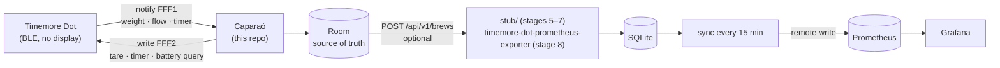

# Architecture

## System context

- The phone is the source of truth ([ADR 0003](adr/0003-offline-first.md)). Without a server, nothing changes except
  that brews show as "local only".
- The scale stays in its standard mode and only streams readings; brew detection (first drop, end of flow) runs in the
  app ([ADR 0006](adr/0006-brew-detection-in-app.md)).
- The app talks to the scale only while it is open; the screen stays on during a brew ([ADR 0008](adr/0008-connect-while-open.md)).

## Code structure

One Gradle module; packages by layer, features inside `ui/` ([ADR 0011](adr/0011-code-structure.md)). Paths are
relative to `app/src/main/java/io/github/mateuxlucax/caparao/`. Packages marked *planned* arrive with the stage shown.

| Package | Responsibility |
|---------|----------------|
| (root) | `MainActivity` (permission and Bluetooth intents, local network permission, debug replay extras), `CaparaoApplication`, `AppContainer` (manual DI), `UploadWorker` (WorkManager entry point; its name is persisted) |
| `model` | Plain entities: `BrewMode`, `ScaleReading`, `ScaleBattery`, `ScaleState`, `ScaleError`, `Brew`, `BrewSample`, `SyncError` (kind, retryable or not) |
| `data` | `scale/`: `DotProtocol` (UUIDs, commands, CRC-16/MODBUS encoders), `FrameDecoder` (chunks to `ScaleMessage`s), `ScaleSource` (the seam the UI sees), `ScaleClient` (connection, handshake, battery poll, backoff) over `BleTransport` (`AndroidBleTransport`: one GATT operation at a time, bond), `ReplayScaleSource` (recorded sessions for the emulator). `local/`: `SettingsStore` (also the server, last sync and last error), `BrewDatabase` (Room: `brews`, `brew_samples`), `BrewRepository`. `exporter/`: `ExporterClient` (the contract's body, `POST /api/v1/brews`, connection check, no redirects). `network/`: `ServerUrl` (validation, cleartext warning), `LocalNetwork` (Android 17 local network permission) |
| `brew` | Pure brew logic, fed with timed readings: `BrewDetector` with `EspressoDetector` (cup → auto tare → first drop → flow stops) and `FilterDetector` (tare → first water → Done or dripper lifted), `FlowSmoother` (least-squares slope over 1 s), `BrewSummary` (numbers and the ≤ 10 Hz curve) |
| `sync` | `UploadScheduler` (when to enqueue: after a save, all unsynced when a server is saved; never without one) over `UploadQueue` (`WorkManagerUploadQueue`: unique work per brew), `UploadRunner` (one upload: marks synced, records the error, retry or not), `SyncErrors` (exceptions to `SyncError`) |
| `ui` | `App` (onboarding gate, tabs, brew and brew detail on top, scale started and stopped with the app's visibility), `theme`, `format`, `components` (logo, pour animation, scale readout ring), `onboarding`, `home`, `brew` (dose → live → saved), `brews` (list, detail, Canvas chart, sync status), `settings` (`ServerViewModel`, shared with the onboarding server step) |

Outside the app module: `probe/` (stage 0 throwaway recorder, [spike.md](spike.md)), `stub/` (Go development server)
and `contract/` (the upload schema and the JSON files both sides test against).

Imports go one way: `model <- data <- brew <- sync <- ui <- root`. Only `ui` (and the root) uses `R` and
`BuildConfig`. `LayerDependencyTest` enforces both.

## Trust boundaries

- BLE: the Dot accepts one bonded phone at a time; frames from it are parsed defensively (bounded lengths, resync).
- Network: only the server the user configures, with a Bearer token; redirects are never followed. Cleartext HTTP is
  allowed (`usesCleartextTraffic`) for LAN servers, and the form warns when it goes to a public host. The token is
  never logged or put in an error.
- Storage: app data is excluded from cloud backups and device transfers (`data_extraction_rules.xml`).
- Repository: no secrets; signing keys come from environment variables; gitleaks runs before every commit.
